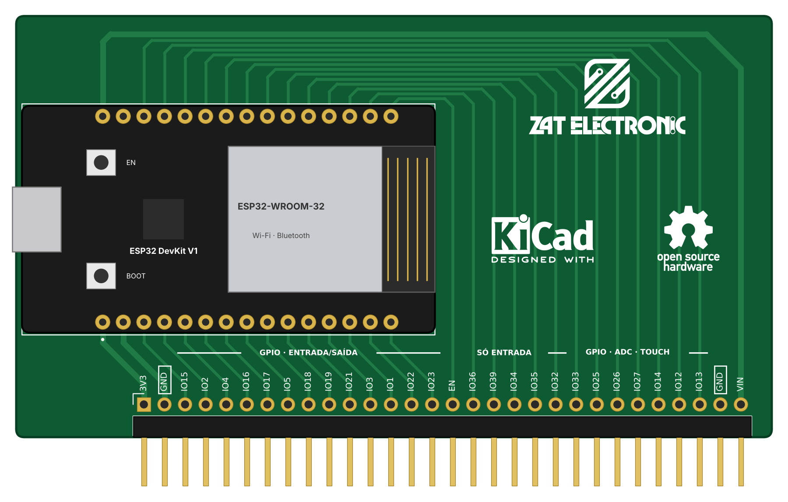
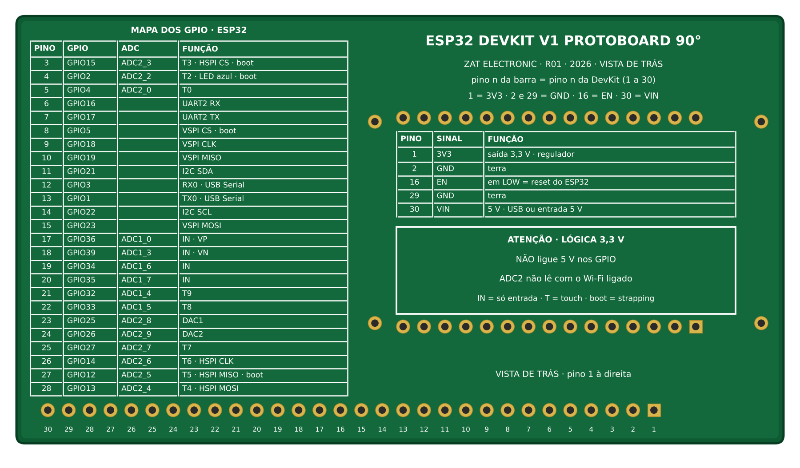

# ESP32 DEVKIT V1 PROTOBOARD 90° — ESP32 DevKit V1 (30 pinos) em pé na protoboard

Placa adaptadora da **Zat Electronic**: a **ESP32 DevKit V1 (DOIT, ESP32-WROOM-32, 30 pinos)** encaixa em 2 barras fêmea 1×15 e **todos os 30 pinos** saem numa **barra de pinos 1×30 a 90°** na borda de baixo. A placa fica **em pé na protoboard** e ocupa só **uma linha de furos por pino** — a DevKit larga deixa de cobrir a protoboard inteira.

  

## Funcionalidades
- ✅ **ESP32 DevKit V1 30 pinos** removível, em 2 barras fêmea 1×15
- ✅ **Barra 1×30 90°** na borda: **pino n da barra = pino n da DevKit** (1 → 30 da esquerda para a direita, vista de cima)
- ✅ Nome de cada pino na serigrafia (frente), **GND destacados em caixa** e **grupos** (GPIO · ENTRADA/SAÍDA · SÓ ENTRADA · GPIO · ADC · TOUCH)
- ✅ **Antena sem cobre embaixo**: área de keepout (sem trilha, via nem zona) sob a antena do WROOM-32
- ✅ **Verso didático com tabelas de traços** (letra ≥ 0,9 mm): mapa dos 25 GPIO (ADC · touch · UART · I2C · SPI · DAC · strapping), tabela de alimentação/controle e quadro de atenção 3,3 V
- ✅ Logos ZAT ELECTRONIC, KiCad e Open Source Hardware na frente
- ✅ Cantos arredondados (r = 1 mm)
- ✅ Roteamento numa camada só, **sem via**, sem cruzamentos; GND sólido no verso
- ✅ 3V3, VIN e GND com trilha de 0,6 mm (net class POWER); sinais 0,3 mm
- ✅ 100% THT · 2 camadas · **93,22 × 51,97 mm**

## Pinagem da barra J1 (vista de cima, da esquerda para a direita)

| J1 | Sinal | J1 | Sinal | J1 | Sinal |
|---|---|---|---|---|---|
| 1 | 3V3 | 11 | GPIO21 (SDA) | 21 | GPIO32 |
| 2 | GND | 12 | GPIO3 (RX0) | 22 | GPIO33 |
| 3 | GPIO15 | 13 | GPIO1 (TX0) | 23 | GPIO25 (DAC1) |
| 4 | GPIO2 | 14 | GPIO22 (SCL) | 24 | GPIO26 (DAC2) |
| 5 | GPIO4 | 15 | GPIO23 | 25 | GPIO27 |
| 6 | GPIO16 (RX2) | 16 | EN | 26 | GPIO14 |
| 7 | GPIO17 (TX2) | 17 | GPIO36 (VP) | 27 | GPIO12 |
| 8 | GPIO5 | 18 | GPIO39 (VN) | 28 | GPIO13 |
| 9 | GPIO18 | 19 | GPIO34 | 29 | GND |
| 10 | GPIO19 | 20 | GPIO35 | 30 | VIN |

## Verso da placa (mapa dos GPIO)

  

Como ler: `ADC2_3` = ADC2 canal 3; `T3` = touch 3; `IN` = só entrada (GPIO34/35/36/39, sem pull-up interno); `boot` = pino de strapping (GPIO0*, 2, 5, 12, 15) — evite carga que force nível no boot. *GPIO0 não sai no DevKit de 30 pinos.

## Montagem
1. Solde as **2 barras fêmea 1×15** nos furos da DevKit (fileiras a 25,4 mm).
2. Solde a **barra 1×30 90°**: corpo plástico deitado sobre a placa, pinos saindo pela borda de baixo.
3. Encaixe a DevKit (USB para a esquerda, antena para a direita, pino 1 = 3V3 no quadrado) e espete a placa em pé na protoboard.

## Cuidados
- Lógica **3,3 V**, sem proteção: não ligue 5 V nos GPIO.
- **ADC2** (GPIO 0, 2, 4, 12–15, 25–27) não lê com o Wi-Fi ligado — use ADC1 (GPIO 32–39).
- **GPIO12** em HIGH no boot muda a tensão da flash: deixe-o livre ou em LOW ao ligar.
- **VIN** = 5 V (USB ou fonte externa). **3V3** é saída do regulador da DevKit — consumo externo limitado.
- Não coloque metal nem cobre perto da antena (lado direito).

## Lista de materiais
| Ref. | Qtd | Item | Footprint |
|---|---|---|---|
| U1 | 1 | ESP32 DevKit V1 DOIT 30 pinos (ESP32-WROOM-32) | ZAT_Board_Espressif:ESP32-DEVKIT-V1 |
| — | 2 | Barra fêmea 1×15 passo 2,54 mm (encaixe da DevKit) | nos furos do U1 |
| J1 | 1 | Barra de pinos macho 1×30 90° passo 2,54 mm | ZAT_Connector:PinHeader_1x30_P2.54mm_Horizontal_EdgeMount |

## Esquemático (KiCad 10)
| Pág. | Folha | Conteúdo |
|---|---|---|
| 1 | Capa (A2) | blocos, pinagem colorida da barra, vista da placa |
| 2 | ESP32 | U1 + global labels dos 30 pinos + **função de cada pino ao lado do label** + legenda |
| 3 | BARRA_90 | J1 1×30 90° com a função de cada pino |

## Arquivos
- `ESP32_DEVKIT_V1_PROTOBOARD_90.kicad_pro` — projeto KiCad 10 (bibliotecas globais KiCad + ZAT, sem pasta lib)
- `Zat_TitleBlock.kicad_wks` — moldura Zat Electronic

## Licença / autor
Projeto **Zat Electronic** — Kenneth Zat · Osasco/SP · hardware aberto.

*Revisão R01 — 2026-11-14 — KiCad 10.*
